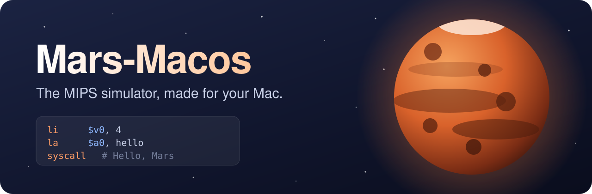
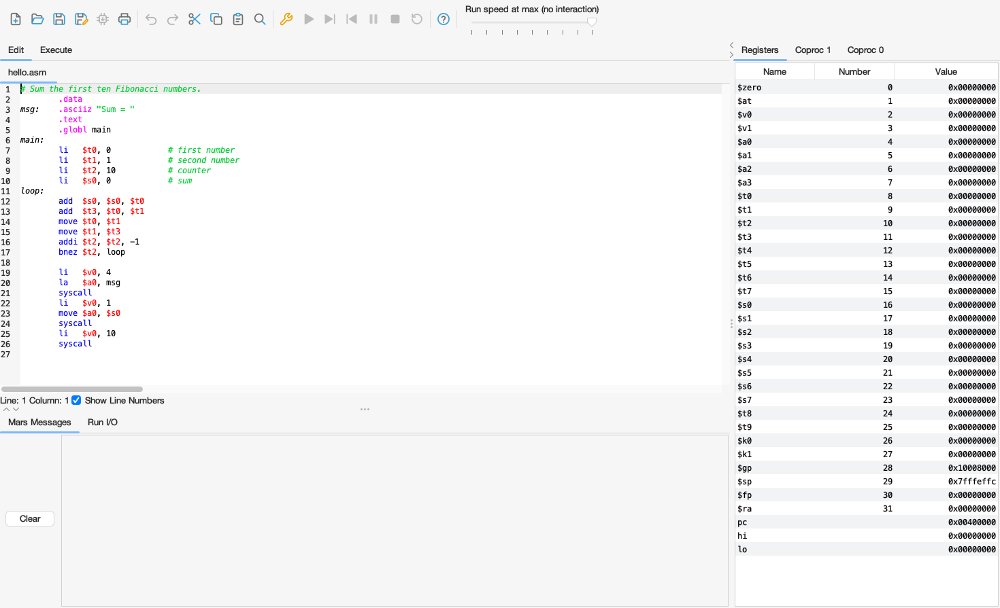
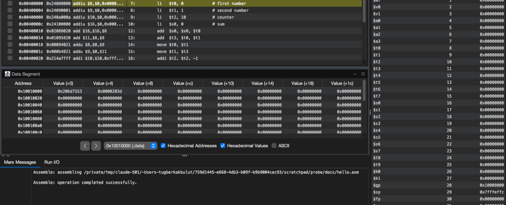

<p align="center">
  
</p>

<p align="center">
  <a href="https://github.com/Tuguberk/Mars-Macos/releases/latest"></a>
  <a href="https://github.com/Tuguberk/Mars-Macos/actions/workflows/build.yml"></a>
  
  <a href="MARSlicense.txt"></a>
</p>

<p align="center">
  <a href="https://github.com/Tuguberk/Mars-Macos/releases/latest"><b>Download for Mac</b></a>
  &nbsp;·&nbsp; <a href="#install">Install</a>
  &nbsp;·&nbsp; <a href="#use-it-from-the-terminal">Terminal</a>
  &nbsp;·&nbsp; <a href="#ai-agents">AI agents</a>
  &nbsp;·&nbsp; <a href="#build-from-source">Build</a>
</p>

<p align="center">
  <picture>
    <source media="(prefers-color-scheme: dark)" srcset=".github/assets/editor-dark.png">
    
  </picture>
</p>

Mars-Macos is an **unofficial** macOS version of [MARS](https://github.com/dpetersanderson/MARS), the MIPS Assembler and Runtime Simulator. You write MIPS, run it, and watch every register and memory word. MARS itself is the same. The app around it now feels at home on a Mac.

## What is new

<table>
  <tr>
    <td width="50%"><b>A real Mac app</b><br>Mac menu bar, Mac shortcuts, and open <code>.asm</code> files from Finder. Java is inside the app.</td>
    <td width="50%"><b>Light and dark</b><br>Follows macOS while the app is open, and the editor changes too.</td>
  </tr>
  <tr>
    <td><b>System windows</b><br>The Mac file windows, color panel, and Fonts panel.</td>
    <td><b>Your work stays</b><br>Files reload when another editor changes them. Open tabs come back at the next start.</td>
  </tr>
  <tr>
    <td><b>A <code>mars</code> command</b><br>Run programs from the terminal in about a third of a second.</td>
    <td><b>Updates inside the app</b><br>It finds a new version, checks the download, and restarts.</td>
  </tr>
  <tr>
    <td><b>Ready for AI agents</b><br>A skill teaches your coding agent how to run and debug MIPS.</td>
    <td><b>Same simulator</b><br>Tests compare the results with the official MARS 4.5.</td>
  </tr>
</table>

<p align="center">
  
</p>

## Install

1. Download the `.dmg` file from [the latest release](https://github.com/Tuguberk/Mars-Macos/releases/latest). It is for Apple Silicon Macs.
2. Open it and drag **Mars-Macos** to **Applications**.
3. The app has no Apple Developer ID yet, so macOS blocks the first start. Open the app once, then go to **System Settings > Privacy & Security** and click **Open Anyway**.

The app checks for a new version once a day. You can turn this off in the **Settings** menu, or check yourself with **Help > Check for Updates**.

## Use it from the terminal

Choose **Settings > Install mars Terminal Command...** in the app. Then:

```sh
mars hello.asm                    # run a program
mars 1000000 t0 v0 hello.asm      # stop after 1,000,000 steps and show registers
mars h                            # show all options
```

## AI agents

<p align="center">
  
</p>

The app adds the [`mars-mips` skill](skills/mars-mips/SKILL.md) for the agents it finds on your computer. Claude Code reads it from `~/.claude/skills`. Codex, Cursor, Copilot, and OpenCode read it from `~/.agents/skills`. The app writes only this one skill and keeps its path current. To stop this and remove the skill, turn off **Settings > Install Skill for AI Agents**.

Then you can ask your agent things like *"Why is `$s0` wrong at the end of this program?"*. The agent runs your program and reads the real values. It does not guess.

You can also add the skill without the app:

```sh
npx skills add Tuguberk/Mars-Macos
```

## Build from source

You need JDK 21.

```sh
scripts/build.sh           # makes build/Mars.jar
scripts/test.sh            # compares results with official MARS
scripts/package-macos.sh   # makes the Mac app and the dmg
```

On Windows and Linux, run `java -jar build/Mars.jar`. These systems get the modern look, sharp icons, system file windows, file reload, and open tabs at the next start. There is no ready package for them yet.

## Credits

MARS was made by **Pete Sanderson** and **Kenneth Vollmar**. Mars-Macos is not made by them. Learn about the original at [dpetersanderson.github.io](https://dpetersanderson.github.io/).

Mars-Macos uses [FlatLaf](https://github.com/JFormDesigner/FlatLaf) and [JSVG](https://github.com/weisJ/jsvg). MARS is under the [MIT license](MARSlicense.txt). Library licenses are in [`lib/licenses`](lib/licenses).
